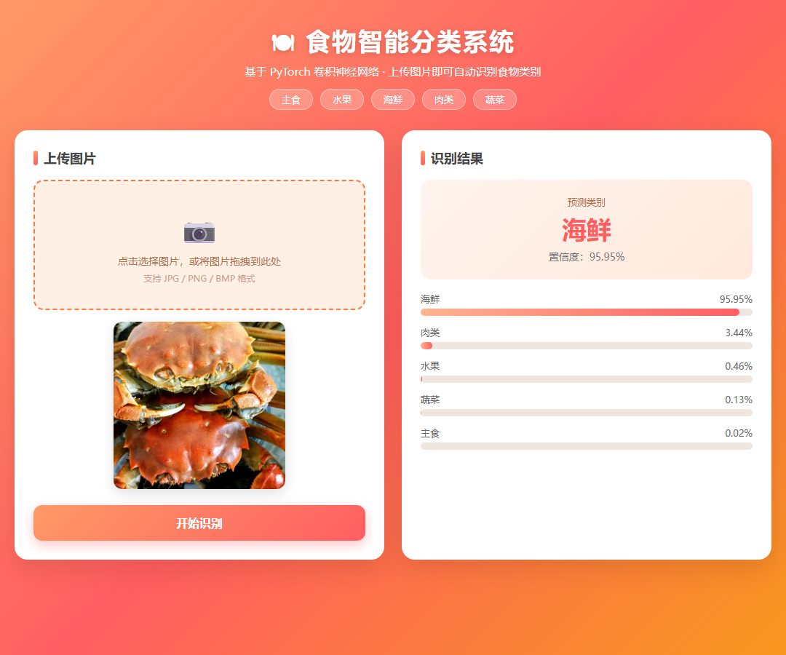

# 食物智能分类系统

基于 PyTorch 卷积神经网络（CNN）的食物图像分类项目，提供 Flask 网页可视化界面，支持**上传图片自动识别食物类别**并显示置信度。

## 分类类别（5 类）

| 类别 | 采集关键词 |
|---|---|
| 主食 | 米饭、面条、馒头、饺子、面包 |
| 水果 | 苹果、香蕉、橙子、葡萄、西瓜 |
| 肉类 | 红烧肉、牛排、烤肉、鸡腿、五花肉 |
| 蔬菜 | 白菜、西兰花、黄瓜、西红柿、胡萝卜 |
| 海鲜 | 螃蟹、虾、龙虾、扇贝、三文鱼 |

## 数据集

- 共采集 **325 张有效图片**（每类 65 张），满足训练量不少于 200 张的要求。
- 按 **8:2** 划分：训练集 260 张、测试集 65 张。

## 技术栈

- 深度学习：PyTorch 2.11.0、torchvision 0.26.0
- 前端：Flask + HTML/CSS/JavaScript（原生，支持点击与拖拽上传）
- 图像处理：Pillow
- 可视化：matplotlib（训练曲线）
- 运行设备：CPU（有 GPU 自动切换，无需改代码）

## 目录结构

```
food_classification/
├── download_data.py      # 百度图片采集
├── split_data.py         # 训练/测试集划分（8:2）
├── train_cnn.py          # CNN 模型训练
├── app.py                # Flask 前端服务
├── templates/index.html  # 网页界面
├── models/               # 模型输出目录（.pth 已忽略，训练后生成）
├── static/uploads/       # 上传图片缓存
├── screenshots/          # 前端截图
└── training_history.png  # 训练曲线
```

## 快速开始

```bash
# 1. 安装依赖
pip install -r requirements.txt

# 2. 采集图片（约 325 张）
python download_data.py

# 3. 划分数据集
python split_data.py

# 4. 训练模型（CPU 约数分钟）
python train_cnn.py

# 5. 启动网页前端
python app.py
```

浏览器打开 http://127.0.0.1:5000 ，上传食物图片即可查看识别类别、置信度及各类别概率。

## 实验结果

- **测试集准确率：92.31%**
- 训练 20 个 epoch，Adam 优化器（lr=0.001）。
- 前端实测：上传螃蟹图片，正确识别为「海鲜」，置信度 95.95%。

## 前端截图


